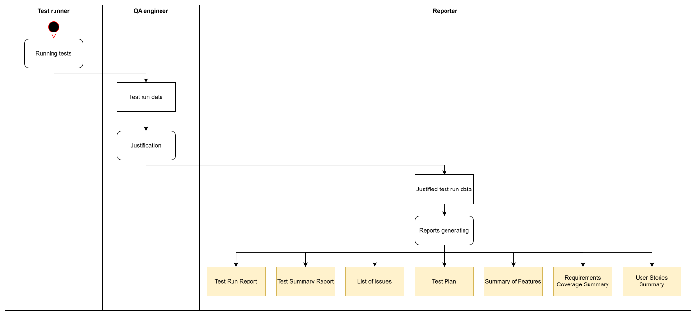
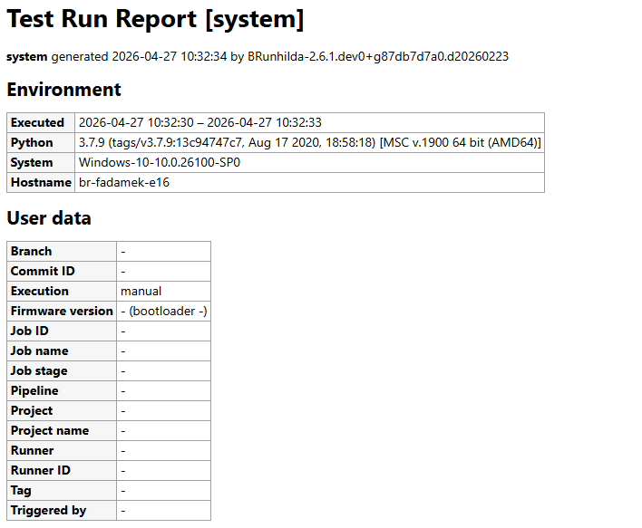
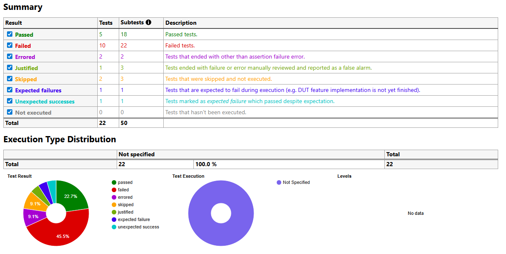
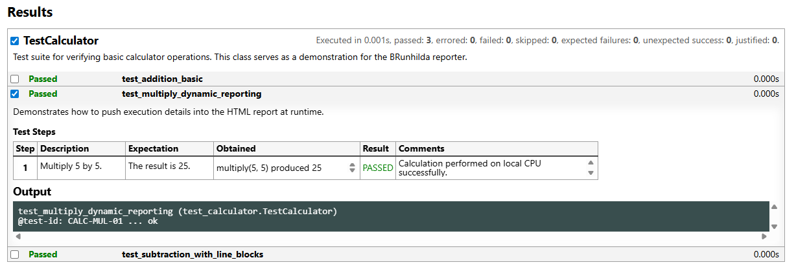
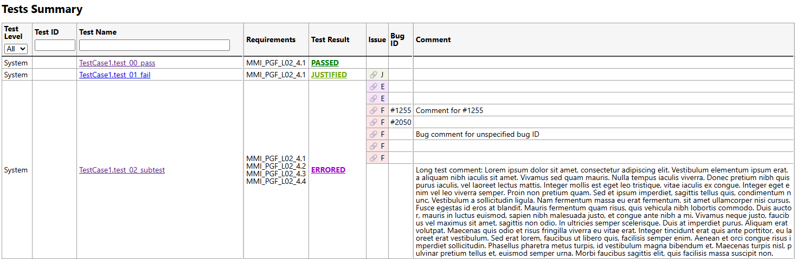
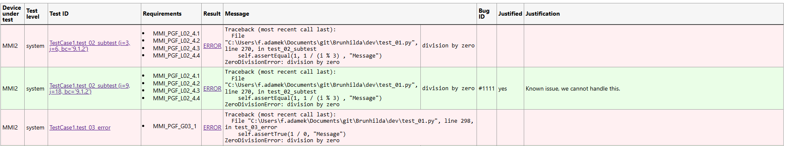
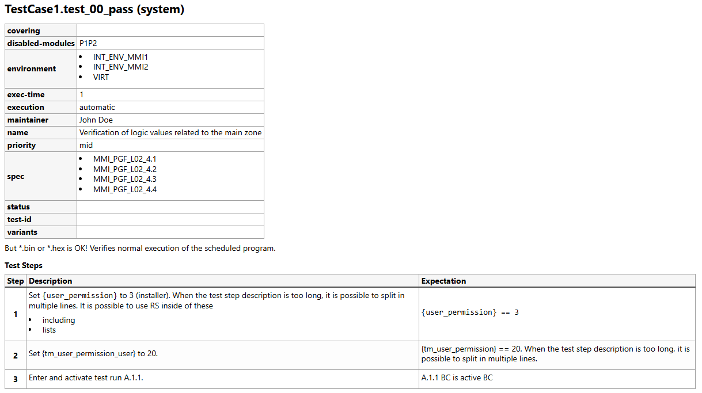
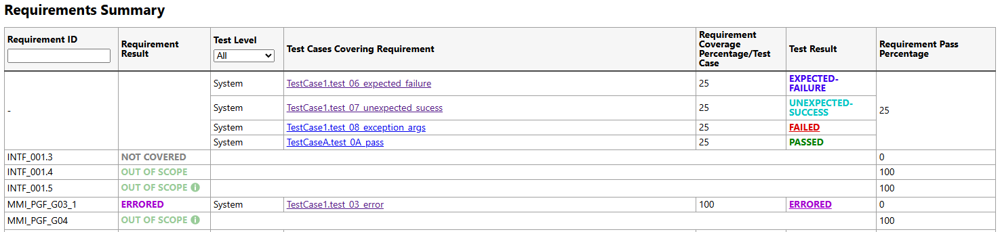
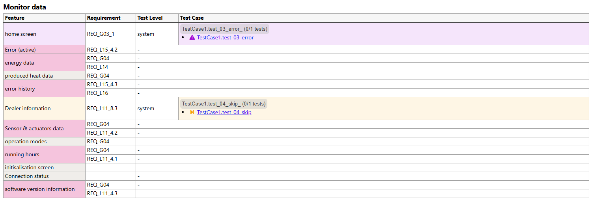

# Consumer Guide

This document provides a comprehensive overview of the reports generated by BRunhilda. It is designed to help stakeholders, QA engineers, and developers interpret test results accurately and navigate the reporting interface effectively.

## Introduction

The primary goal of BRunhilda reports is to transform raw execution data into an intuitive, visual format. These reports provide a clear snapshot of software quality at any given moment, allowing for quick identification of regressions and bottlenecks.

## Workflow

This section describes simplified BRunhilda workflow to help understanding how the reports are created.

All begins with tests definition and tests docstring which provides additional information about the test. The next step is test execution, which results into information about test run and tests itselfs. After getting test run data, QA engineer usually check the results and justify test results. The last step of this whole procedure is reports generating.

## Terminology

To interpret the reports correctly, it is essential to understand both the outcomes of test executions and the conceptual framework of the project.

### Core Concepts

- **Feature**: A high-level business functionality (e.g., "DHW Setpoint" or "Reboot"). Features are organized into logical Groups and are defined by Requirements.
- **Requirement**: A specific technical specification imported from external sources. Each Requirement is covered by one or more Test Cases to verify its implementation.
- **Test (Test Case)**: A technical script or manual procedure that executes a specific scenario. It serves as the primary unit of verification for Requirements.
- **Sub-test**: Individual iterations within a single Test Case, often used for parameterized testing. If a Test does not explicitly use sub-tests, the reporting engine counts the Test itself as one sub-test.
- **Issue**: Any execution that results in a Failed or Errored status. Issues are tracked with technical details like tracebacks, screenshots, and associated Bug IDs.

### Test Outcomes

- **Passed**: The test executed all steps successfully and met all assertions.
- **Failed**: The test failed due to an assertion error (e.g., expected value did not match actual value). This usually indicates a bug in the application.
- **Errored**: The test could not be completed due to an unexpected environment issue, setup failure, or a crash in the test script itself.
- **Justified**: A failure or error that has been manually reviewed. It is marked as a "false alarm" or a known environmental issue that doesn't require immediate fix.
- **Skipped**: Tests that were excluded from the current run (e.g., due to tags, dependencies, or manual exclusion).
- **Expected Failure**: A known issue where failure is anticipated (e.g., a feature still in development). These results do not count against the "Failed" total in high-level summaries.
- **Unexpected Success**: A test marked as an Expected Failure that surprisingly passed. This usually indicates that a fix was deployed or the test criteria need updating.
- **Not Executed**: A test wasn't executed, just it's artifacts were get via dry run.

## Reports description

### Test Run Report

The Test Run Report is the primary output for a single execution of a test suite. It provides both a high-level executive summary and granular technical details.

#### 1. Header and Contextual Data

The top of the report contains essential metadata about the execution environment:

- **Environment Summary**: Details about the Python version, operating system, and the hostname of the runner.
- **User Data**: Project-specific information including Git branch/commit, firmware versions, and pipeline IDs to ensure full traceability of the test run.

|  |
| :--: |

#### 2. Summary Dashboard

The dashboard provides an immediate snapshot of the test run's health:

- **Statistics Table**: Shows counts for both Tests (high-level scenarios) and Subtests. Note that tests without subtests are counted as a single subtest.
- **Visual Distribution**: Pie charts illustrate the ratio of different results, execution types, and test levels (e.g., Component, System).
- **Interactive Filters**: You can toggle the visibility of specific results in the list below by clicking the checkboxes in the summary table.

|  |
| :--: |

#### 3. Detailed Test Results

Each test case can be expanded to access the following sections:

- **Test Steps**: A detailed table showing each action, the expected outcome, and the actual result obtained during execution.
- **Console Output**: Raw execution logs with color-coded severity levels (DEBUG, INFO, WARNING, ERROR, CRITICAL).
- **Tracebacks**: Precise technical details and error messages for any Failed or Errored tests.
- **Extra Artifacts**: Supplemental evidence such as Screenshots (captured at the moment of failure) or complex data objects (dictionaries/lists).
- **Sub-tests Table**: For tests using iterations, this section provides a dedicated breakdown of each individual sub-test run.

|  |
| :--: |

### Test Summary Report

The Test Summary Report provides a consolidated view of results from multiple test runs. It is the ideal tool for tracking overall project status, requirement coverage, and known issues across different testing levels.

#### 1. Executive Summary & Interactive Toggles

At the top of the report, you will find a high-level statistics table:

- **Result Counts**: Displays the total number of tests categorized by result.
- **Interactive Toggles**: Each result in the summary table has a checkbox. Unchecking a box will instantly hide tests with that result from the detailed table below, allowing you to focus on specific areas (like only Failed or Errored tests).

#### 2. Execution Type & Distribution

This section breaks down how tests were executed across different levels:

- **Execution Types**: Shows the distribution of eg., Automatic vs. Manual executions.
- **Percentage Breakdown**: Provides a percentage-based view of execution coverage for each test level.

#### 3. Visual Analysis (Charts)

Three interactive pie charts provide a quick visual assessment of the project:

- **Test Result**: Proportional view of all test outcomes.
- **Test Execution**: Visualizes the ratio of tests execution tags. The tag is usually automated (test runs on CI) or manual (test is started manually).
- **Levels**: Shows the distribution of tests across testing levels (e.g. integration, system, ...).

#### 4. Detailed Tests Summary Table

The core of the report is a comprehensive table listing every executed test with the following columns:

- **Filters**: You can narrow down the list using the Test Level dropdown or by typing into the Test ID and Test Name search fields which supports `&` (AND), `|` (OR), `!` (NOT), `*` (any string) and `?` (single character), keep in mind that `&` has priority over `|`.
- **Requirements**: Lists the specific project requirements mapped to each test case.
- **Test Result (with Links)**: Each result (e.g., "PASSED", "FAILED") is a clickable link that takes you directly to the specific Test Run Report for that execution.
- **Issue**: Direct link (🔗) to detailed issue descriptions ([List of Issues](#list-of-issues)). This cell is tinted by test result, it's useful for subtests result visualization.
- **Bug ID**: Displays associated tickets from issue tracking system.
- **Comment**: Notes from the QA engineer (for issues) or notes from the test run, usually reason of test skip.

|  |
| :--: |

### List of Issues

The List of Issues report is a specialized view that filters out all successful tests and focuses exclusively on items requiring investigation. It is particularly useful for developers and QA leads who need to triage multiple failures without jumping between individual test run files.

#### 1. The Issues Table

The report is structured as a detailed table where each row represents a specific failure or execution error.

- **Device under test**: Specifies which hardware or environment instance (DUT) the failure occurred on.
- **Test ID / Name**: Provides a link to the test definition in the [Test Plan](#test-plan).
- **Requirements**: Lists all project requirements linked to the failing test.
- **Result**: Shows the outcome (FAIL or ERROR) and provides a direct link to that specific execution in the [Test Run Report](#test-run-report).
- **Message**: Displays the technical Traceback. This shows exactly which line of code triggered the failure and the specific error type (e.g., ZeroDivisionError or AssertionError).
- **Extra**: Houses contextual evidence. This often includes screenshots captured at the moment of failure and captured data structures (dictionaries or lists).

#### 2. Triage & Justification

One of the most powerful features of this report is the ability to track the triage process:

- **Bug ID**: Displays the ticket number (e.g., #1255) if the issue has been logged in an external bug tracking system.
- **Justification**: Shows the reasoning provided by a reviewer for why a failure might be considered a "false alarm" or a known environment issue.
- **Visual Indicators**:
  - 🔴 Reddish Rows: These are "new" or unreviewed issues that require immediate attention.
  - 🟢 Greenish Rows: These represent issues that have been manually reviewed and marked as "Justified." They are still failures, but they are acknowledged by the team.

|  |
| :--: |

### Test Plan

The Test Plan provides a structured, human-readable documentation of all available test cases. It extracts docstrings and special annotations from the test scripts to present a clear picture of the testing scope.

#### 1. Navigation & Table of Contents

At the beginning of the report, a Table of Contents lists all included tests.

- **Direct Links**: Each item in the list is a clickable link that jumps directly to the specific test definition.
- **Naming Convention**: Tests are listed by their class and method name, followed by their Test Level in parentheses.

#### 2. Test Definitions

Each test case is presented in its own section containing three primary components:

- **Test Tags (Metadata)**: This section displays technical metadata and categorization for the test. Depending on the test configuration, you may see:
  - **Requirement Coverage (spec / covering)**: The specific IDs of project requirements or specifications addressed by this test.
  - **Execution Details**: The execution type (automatic or manual), expected exec-time, and the designated environment.
  - **Management Info**: Information regarding the maintainer (owner), priority (high/mid/low), and current status.
- **Description**: The Description block provides a high-level overview of the test's objective. It explains the "why" behind the test case and any specific scenarios it aims to verify. This text supports rich formatting, including lists and code-style fonts for clarity.
- **Test Steps**: The Test Steps table is the most granular part of the plan, detailing the exact procedure:
  - **Step Number**: The order of operations.
  - **Description**: The specific action the test runner or manual tester must perform.
  - **Expectation**: The criteria for success for that specific step. If the actual behavior deviates from this expectation during a run, the test is marked as Failed.

|  |
| :--: |

### Requirements Coverage Summary

The Requirements Coverage Summary provides a comprehensive view of how project requirements are being addressed by a test suite. It serves as a bridge between high-level project specifications and technical test execution.

#### Core Concept

This report maps imported requirements to specific test cases. It calculates coverage metrics and determines an overall status for each requirement.

##### Out of Scope Requirements

A key feature of this report is the ability to mark requirements as Out of Scope.

- **Definition**: This status explicitly indicates that a requirement is not planned to be tested on our side for the current project scope.
- **Justification**: Out of Scope requirements may include an optional justification note (visible via the info icon) explaining why they are excluded.

##### Requirement Evaluation Policy

It is important to note that the final Requirement Result (e.g., whether a requirement is marked as "Passed" or "Errored") is not fixed. The report creator can define a custom evaluation policy. This means the logic that determines the final status based on the underlying test results can be adjusted to fit specific project needs.

#### Report Sections

##### 1. Summary Dashboard & Filtering

The top of the report features a statistical breakdown and a pie chart showing the distribution of requirement statuses.

- **Interactive Toggles**: You can use the checkboxes in the summary table to filter the detailed list. For example, you can hide all "Out of Scope" requirements to focus only on those currently under test.

##### 2. Detailed Coverage Table

The main table provides a granular look at each requirement ID and its associated tests:

- **Requirement ID**: The unique identifier imported from requirement source. You can narrow down the list using by typing into the Requirement ID search field which supports `&` (AND), `|` (OR), `!` (NOT), `*` (any string) and `?` (single character), keep in mind that `&` has priority over `|`.
- **Requirement Result**: The overall status determined by the specific project evaluation policy.
- **Test Cases Covering Requirement**: A list of all test cases linked to this ID, including direct links to their definitions in the [Test Plan](#test-plan).
- **Requirement Coverage Percentage**: Shows the weight or contribution of each individual test case toward the total requirement verification.
- **Test Result**: The outcome of the individual test execution (e.g., Passed, Failed, Errored).
- **Requirement Pass Percentage**: A calculated metric representing the aggregate success rate for that specific requirement.

|  |
| :--: |

### Summary of Features

The Summary of Features report provides the highest-level perspective on the project, grouping technical test results into logical business functionalities. It organizes imported features into thematic sections, mapping them directly to requirements and their corresponding test executions.

#### Hierarchical Structure

This report follows a specific hierarchy to bridge the gap between high-level project goals and technical verification:

- **Group**: Broad categories like DHW, Monitor data, or Update/Download.
- **Feature**: Specific functional units within a group (e.g., Installer mode or DHW Setpoint).
- **Requirement**: The individual specifications that define a feature.
- **Test Case**: The actual technical scripts executed to verify the requirements.

#### Feature Status & Evaluation

The result of a feature is an aggregate of its underlying requirements and tests.

- **Out of Scope**: Indicates that the feature is intentionally excluded from verification on our side for the current project.
- **Custom Evaluation Policy**: Like the [Requirements report](#requirements-coverage-summary), the logic that determines a feature's final result (e.g., "Passed" vs. "Errored") is flexible. The report creator can define specific policies based on the criticality of the underlying requirements.

#### Report Sections

##### 1. Summary Dashboard & Visualization

The report begins with a statistical overview and a pie chart.

- **Metric Breakdown**: Shows the total count of features categorized by their current status (Passed, Failed, Errored, Not Covered, etc.).
- **High-Level Health**: Provides an immediate visual indicator of how much of the project's total functionality is verified and healthy.

##### 2. Sidebar Navigation (TOC)

A dedicated Table of Contents is located on the right side of the page.

- **Quick Jump**: Allows you to navigate instantly between different functional groups and their nested features.

##### 3. Detailed Features Summary

The main body of the report contains detailed tables for each group:

- **Feature Mapping**: Each row shows a feature and the specific Requirement IDs associated with it.
- **Traceability**: Displays the Test Level (System, Manual, etc.) and the specific Test Case names.
- **Interactive Details**: If a requirement is covered by tests or subtests, a collapsible button with test name is available. Clicking it expands a list of individual results.

|  |
| :--: |
